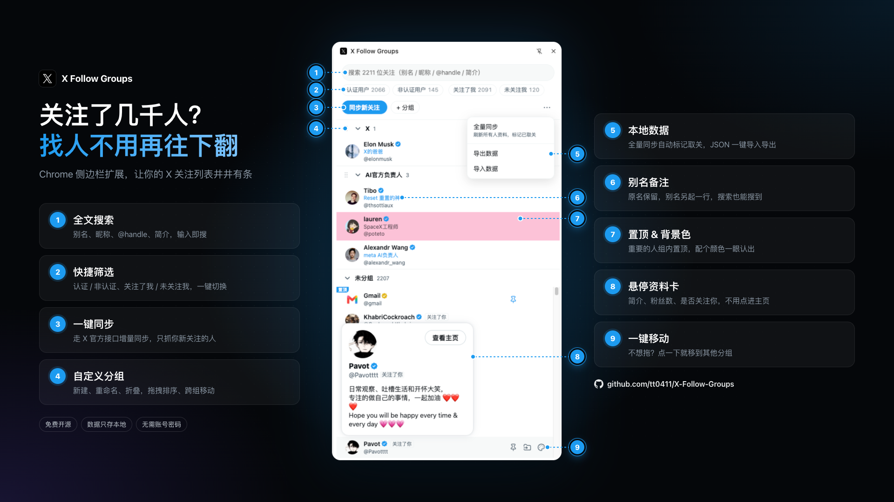

# X Follow Groups

关注了几千人？找人不用再一直往下翻。



X Follow Groups 是一个 Chrome 侧边栏扩展，帮你把 X（Twitter）上的关注列表整理得井井有条：分组、别名、拖拽排序、搜索筛选、置顶、背景色标记，全部在侧边栏里完成，数据只存在你自己的浏览器里。

## 功能

- **一键同步关注列表**：用你已登录的 x.com 会话调用 X 官方网页端接口，增量同步只抓新关注的人，追上已同步过的人就自动停止。
- **全量同步**：遍历整个关注列表，刷新所有人的资料，并把已经取关的人标记为「已取关」。
- **搜索**：按别名、昵称、@handle、简介搜索，命中的分组自动展开。
- **快捷筛选**：认证用户 / 非认证用户、关注了我 / 未关注我，带人数统计，可与搜索叠加。
- **自定义分组**：新建、双击重命名、折叠、删除（组内成员回到「未分组」）。
- **拖拽排序**：组内排序、跨组移动、分组之间排序。
- **移到其他分组**：不想拖时，点卡片上的按钮直接选目标分组。
- **别名**：双击用户卡片设置别名，原名保留，别名另起一行显示，也能被搜索到。
- **组内置顶**：重要的人固定在分组最前面，左上角显示「置顶」标签。
- **背景色**：11 种预设颜色或自定义颜色，确认后生效，可一键恢复默认。
- **资料卡**：鼠标悬停显示简介、关注数、粉丝数、是否关注了你；点头像看大图。
- **导入 / 导出**：整份数据导出为 JSON 备份，换电脑后一键导入。
- **深色模式**：跟随系统。

## 安装

目前需要从源码构建后以「开发者模式」加载：

```bash
npm install
npm run build
```

1. 打开 `chrome://extensions`，开启右上角「开发者模式」。
2. 点「加载已解压的扩展程序」，选择项目里的 `dist` 目录。
3. 点工具栏上的扩展图标，即可打开侧边栏。

## 使用

1. 在 Chrome 里登录 [x.com](https://x.com)。
2. 打开侧边栏，点「同步新关注」。没有打开的 x.com 标签页时，扩展会在后台打开一个。
3. 第一次同步会拉取完整关注列表，之后每次只拉新关注的人。
4. 点「+ 分组」创建分组，把用户拖进去，或用卡片上的「移动到其他分组」按钮。
5. 右上角「⋯」菜单里有「全量同步」「导出数据」「导入数据」。

> 搜索或筛选时会暂时禁用拖拽，清空搜索框和筛选条件后即可恢复。

## 同步机制

- 同步在 x.com 页面的 content script 里发起，直接复用你浏览器里的登录 Cookie，不需要账号密码，也不经过任何第三方服务器。
- 关注接口的 `queryId` 会随 X 每次发版变化，扩展会从 X 的前端代码里自动解析并缓存；接口报错时自动清缓存，下次重新解析。
- 每页 50 人，页与页之间间隔 1.5 秒，接近人工快速滚动的频率。
- 增量同步遇到连续 20 个已知用户就认为已经追上，自动停止。
- 被 X 限流（HTTP 429）时会立即停止，并提示可以重试的时间。
- 新关注的人会插入「未分组」顶部（置顶用户之后），保持「最新关注在最前」。

## 数据与隐私

- 所有数据（用户资料、分组、别名、置顶、颜色）都保存在 `chrome.storage.local`，不会上传到任何地方。
- 卸载扩展会清除这些数据，建议定期用「导出数据」备份。
- 「导入数据」会**覆盖**当前全部数据，导入前会二次确认。

### 权限说明

| 权限 | 用途 |
|---|---|
| `sidePanel` | 在侧边栏中显示界面 |
| `storage` / `unlimitedStorage` | 在本地保存关注列表等数据（几千人的数据会超过默认配额） |
| `tabs` | 查找或打开 x.com 标签页来发起同步 |
| `https://x.com/*` | 在 x.com 页面里调用关注接口 |
| `https://abs.twimg.com/*` | 读取 X 前端代码，解析关注接口参数 |

## 开发

```bash
npm install
npm run dev     # 开发模式（热更新），同样加载 dist/ 目录
npm run build   # 类型检查 + 生产构建，输出到 dist/
```

技术栈：Vite 6、React 18、TypeScript、[@crxjs/vite-plugin](https://github.com/crxjs/chrome-extension-tools)（Manifest V3）、[dnd-kit](https://dndkit.com/)（拖拽）。

### 目录结构

```
manifest.config.ts        扩展清单（MV3）
src/
  background/index.ts     Service Worker：打开侧边栏、协调同步、写入数据
  content/sync.ts         x.com 页面内的同步脚本：分页调用关注接口
  shared/
    types.ts              数据类型与消息定义
    storage.ts            chrome.storage 读写、同步结果合并、取关标记
    following.ts          解析 X 前端代码中的接口参数与接口返回
  sidepanel/
    App.tsx               侧边栏主界面：搜索、筛选、分组列表、菜单
    search.ts             搜索与快捷筛选逻辑
    components/           分组、用户卡片、资料卡、颜色选择器、移动菜单等
    styles.css
```

## 免责声明

本项目与 X Corp. 无关。扩展使用的是 X 网页端的内部接口，X 改版后可能失效；请合理使用同步功能，避免频繁全量同步触发限流。
